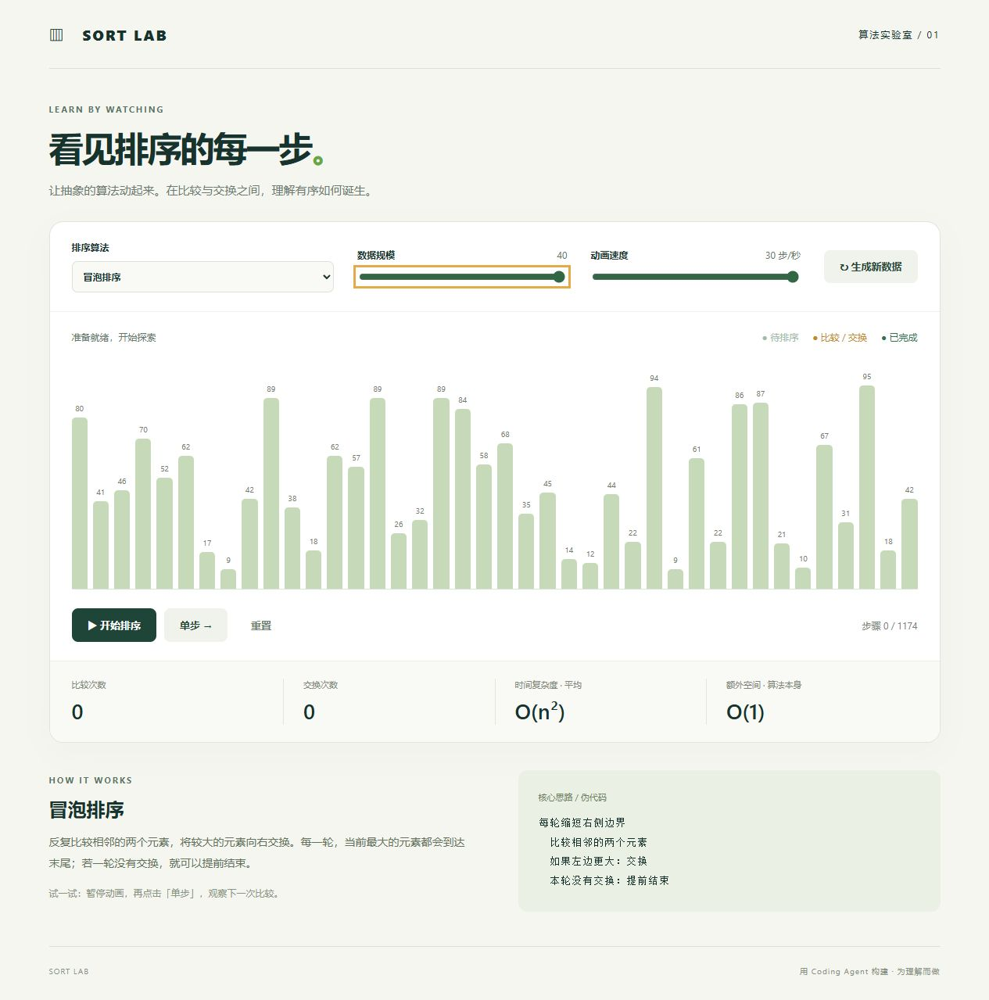

# Sort Lab · 排序算法可视化

一个用 Coding Agent 协助开发的前端小作品，通过动画理解冒泡排序、插入排序和选择排序。

## 运行

直接用浏览器打开 `index.html`，无需安装依赖、无需联网。也可以在项目目录运行 `python -m http.server 8080`，访问 `http://localhost:8080`。

## 功能

- 三种排序算法，配套中文原理说明与伪代码。
- 开始、暂停、继续、单步和重置。
- 5–40 个随机整数，1–30 步/秒的动画速度。
- 比较次数、交换次数与当前进度。
- 手机布局、键盘可操作控件和减少动态效果偏好支持。

绿色浅色柱表示待排序数据，黄色表示当前操作涉及的元素，深绿色表示整个序列排序完成。切换算法会使用同一组初始数据重新开始，方便对比。生成新数据或调整数据规模会开始新的实验。

## 实现

使用原生 HTML、CSS 和 JavaScript。`algorithms.js` 输出不可变的步骤快照，`app.js` 负责播放与界面，算法可以独立测试。插入排序采用相邻交换版本，统计中的交换次数均指两个元素互换。

三种算法平均时间复杂度为 O(n²)，算法本身额外空间为 O(1)。**可视化为每一步保留数组快照，最坏存储复杂度为 O(n³)**，因此限制数据规模为 40。显示的是操作次数，并非性能基准；动画计时可能受浏览器后台限速影响。

## 测试

安装 Node.js 后运行 `node test.cjs`。测试覆盖三种算法的空数组、单元素、重复值、已排序、逆序、负数与固定种子的随机数组；验证最终结果、输入不被修改、每一帧的数据完整性、索引范围与计数。

## 发布到 GitHub

将本目录内容上传到公开仓库。若需要在线演示，可在仓库的 Pages 设置中选择从主分支根目录发布。项目没有服务器、外部请求、密钥或用户数据。

开发过程见 [DEVELOPMENT.md](DEVELOPMENT.md)。
